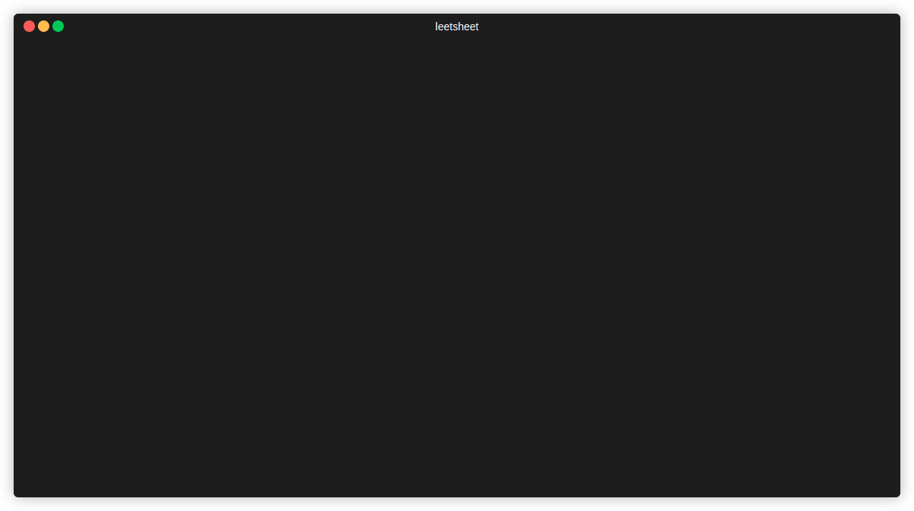
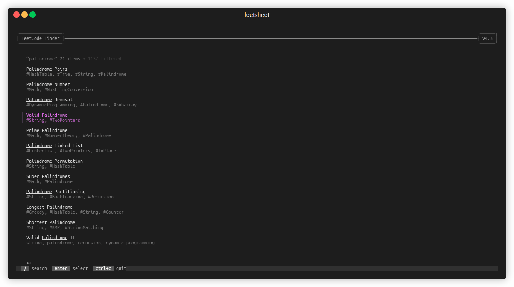
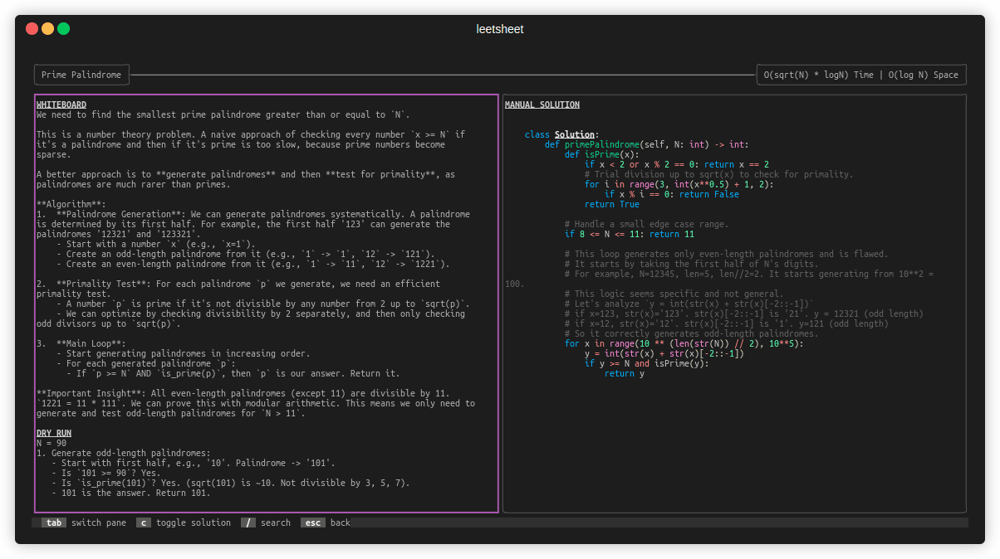

<!-- brand:header:start -->
<picture>
  <source media="(prefers-color-scheme: dark)" srcset="assets/brand/header-5a675ab2-dark.svg">
  
</picture>
<!-- brand:header:end -->

<!-- badges:start -->
[](https://www.repostatus.org/#active)
[](https://github.com/JonathanTSilva/leetsheet/actions/workflows/ci.yml)
[](https://github.com/JonathanTSilva/leetsheet/releases)
[](https://codecov.io/gh/JonathanTSilva/leetsheet)
[](https://sonarcloud.io/summary/new_code?id=JonathanTSilva_leetsheet)
[](https://scorecard.dev/viewer/?uri=github.com/JonathanTSilva/leetsheet)
[](https://www.bestpractices.dev/projects/17154)
[](LICENSE)
[](https://codespaces.new/JonathanTSilva/leetsheet)
<!-- badges:end -->

**Review LeetCode problems without opening a browser.** leetsheet is a fast, offline terminal app: search 1,158 problems, then read the strategy, a dry run, the edge cases, the complexity and two solutions side by side.



<p align="center">
  
  
</p>

*Filter as you type (left), then read the whole walkthrough in two panes (right).*

## What it is

A command-line application for developers who want a quick way to revise problems before an interview or a study session. Everything is read from a local database, so it needs no network.

Every one of the 1,158 problems comes with:

- **Whiteboard explanation:** the high-level strategy and the data structures involved.
- **Dry run:** a step-by-step example to make it stick.
- **Test cases:** the edge cases worth remembering.
- **Complexity analysis:** time and space, each with a justification.
- **Two solutions:** a hand-written, commented one and an AI-generated one, to compare.

And the app around them:

- **Instant search.** The list filters by title as you type.
- **Tag filters.** Type `#Array #HashTable` to find problems by topic, across more than 500 tags.
- **Two-pane problem view.** Details on the left, syntax-highlighted code on the right, with `c` to swap between the manual and AI solution.
- **Vim-style keys and a responsive layout** that adapts to your terminal size.
- **Offline first.** The whole database is compiled into the binary.

## Quick start

You need Go 1.25 or newer (see `go.mod`).

Install it with one command:

```bash
go install github.com/JonathanTSilva/leetsheet@latest
leetsheet
```

`go install` puts the binary in `$(go env GOPATH)/bin`, usually `~/go/bin`, so make sure that directory is on your `PATH`. Or build it from a clone:

```bash
git clone https://github.com/JonathanTSilva/leetsheet.git
cd leetsheet
go build
./leetsheet
```

The binary carries the problem database with it, so you can run it from any directory. To put a built binary on your `PATH`:

```bash
sudo mv leetsheet /usr/local/bin/
```

If a `problems.json` exists in the directory you run it from, leetsheet uses that file instead of the bundled one. That is how you keep your own set of problems.

## Usage

Run `leetsheet` from your terminal. The application is fully keyboard-driven.

| View        | Key             | Action                                |
| ----------- | --------------- | ------------------------------------- |
| **Search**  | `ctrl+c`        | Quit the application                  |
| (Default)   | `/`             | Start filtering (enter search mode)   |
|             | `ctrl+j/k`      | Navigate up/down the problem list     |
|             | `enter`         | Select a problem and view its details |
|             | `esc`           | Clear the current filter/search       |
|             | `#tag`          | Type `#` followed by a tag to filter  |
|             |                 |                                       |
| **Problem** | `esc` / `/`     | Go back to the search view            |
| (Details)   | `tab`           | Switch focus between left/right panes |
|             | `c`             | Toggle between Manual and IA solution |
|             | `↑`/`↓`/`j`/`k` | Scroll the content in the active pane |

### Adding new problems

All problem data is stored in `problems.json`. To add a problem, copy `problems.json` from this repository into the directory you run leetsheet from (or edit it in place if you run from the checkout), then append a JSON object with this structure to the array in that file:

```json
{
  "title": "Your Problem Title",
  "link": "https://leetcode.com/problems/your-problem-name/",
  "keywords": ["#Tag1", "#Tag2"],
  "complexity": {
    "time": {
      "notation": "O(N)",
      "justification": "Explanation for time complexity."
    },
    "space": {
      "notation": "O(1)",
      "justification": "Explanation for space complexity."
    }
  },
  "whiteboard": "A high-level explanation of the approach.",
  "dry_run": "A step-by-step walk-through with an example.",
  "test_cases": "A list of important edge cases to consider.",
  "ia_solution": "The AI-generated code solution string.",
  "manual_solution": "The manually written and commented code solution string."
}
```

JSON requires strings to be escaped (newlines as `\n`, quotes as `\"`). The `code_to_json.py` utility script does this for you:

1. Optionally install `pyperclip` to copy the output to your clipboard automatically: `pip install pyperclip`.
2. Open `code_to_json.py` and paste your multi-line code solution between the triple quotes.
3. Run `python code_to_json.py`.
4. Paste the printed single-line string as the value of `ia_solution` or `manual_solution` in `problems.json`.

## Docs

The repository layout and the engineering standard it follows are described in the [handbook](https://github.com/JonathanTSilva/.github/blob/main/handbook/README.md). Instructions for AI coding agents are in [AGENTS.md](AGENTS.md).

## Built with

- [Go](https://golang.org/): the core language.
- [Bubble Tea](https://github.com/charmbracelet/bubbletea): the TUI framework.
- [Lipgloss](https://github.com/charmbracelet/lipgloss): terminal layouts.
- [Glamour](https://github.com/charmbracelet/glamour): Markdown and syntax-highlighted code rendering.

Thanks to the team at [Charm](https://charm.sh/) for this suite of tools.

## Contributing

See the [contributing guide](https://github.com/JonathanTSilva/.github/blob/main/CONTRIBUTING.md). Branches are `<type>/<issue>-<slug>`, commits and PR titles follow Conventional Commits, and PRs are squash-merged.

## License

Distributed under the MIT License. See [LICENSE](LICENSE) for more information.

<!-- brand:footer:start -->
<p align="right"><a href="https://www.jontobias.com"><picture>
  <source media="(prefers-color-scheme: dark)" srcset="https://raw.githubusercontent.com/JonathanTSilva/.github/main/assets/brand/jontobias-dark.svg">
  
</picture></a></p>
<!-- brand:footer:end -->
